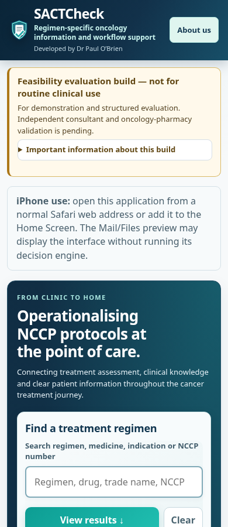
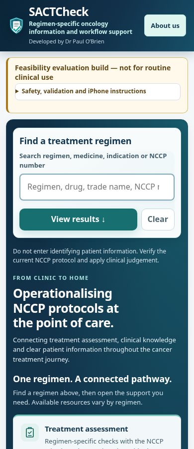
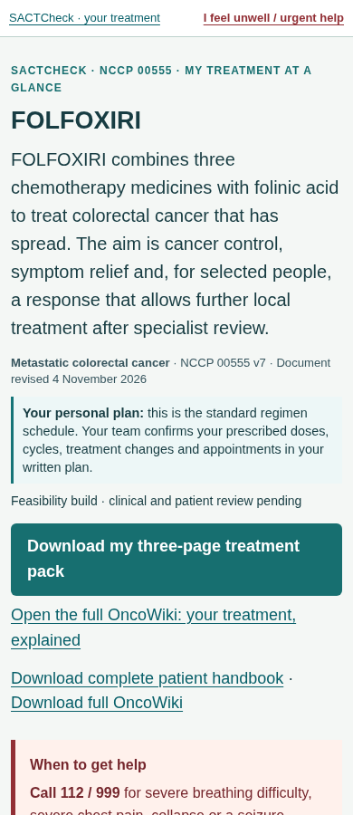
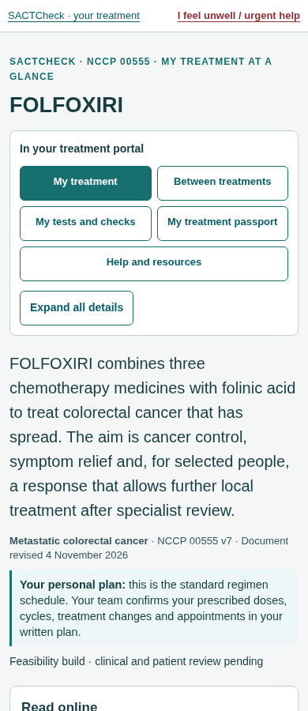
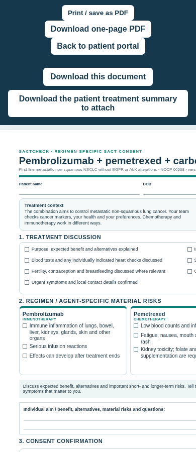
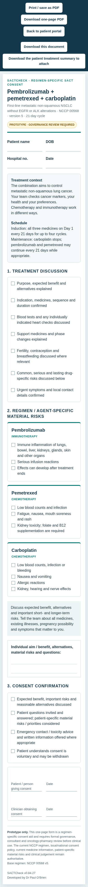
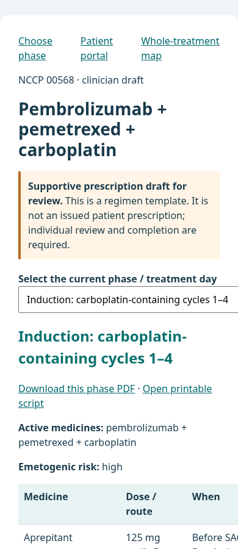
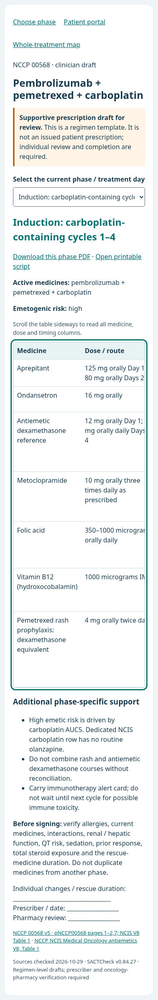
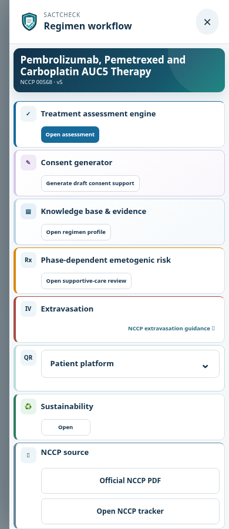
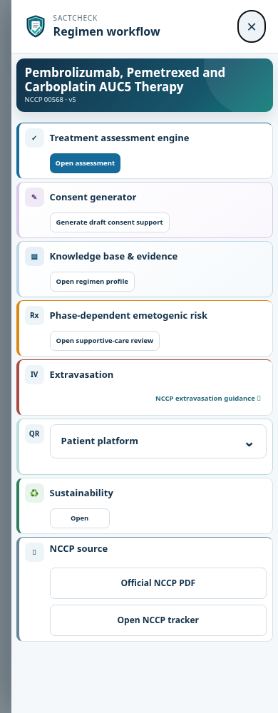

# SACTCheck UI fixes and review evidence

The five improvements from the visual audit are implemented on **`dev/ui-usability-fixes-20261105`**, based on v0.84.33 commit **`4dc3ee85f61f58586f95e7e6e914bd6ed35b15ed`**. This is a development change, with local evidence below. It is not a production release; no merge to `main` or deployment is established by this report.

## What changed

| Priority | Finding | Implemented change and benefit | Classification |
| --- | --- | --- | --- |
| 1 | 00555 showed a 46-hour pump beside its authored 48-hour schedule. | Chart bands now use each authored regimen/phase row verbatim. The 00555 and 00783 examples show their 48-hour instructions; other authored 46-hour regimens retain those timings. This removes contradictory display instructions without replacing them with a new global duration. | Objective display defect |
| 2 | Consent aid and support content extended outside a narrow viewport; consent captions were too faint. | Screen-only consent reflow stacks every drug-risk group, field and signature while retaining A4 print layout. Support selectors fit; complete tables have a named keyboard-scrollable region and visible scrolling cue. Consent captions use `#526975` on white, **5.775:1**, with larger screen text. Readers can reach every risk and timing column. | Objective overflow/contrast defects |
| 3 | Workflow modal left keyboard focus behind the dialog and did not close on Escape. | Initial/loading focus, Tab and Shift+Tab containment, inert background, Escape, close/backdrop behavior, focus restoration and asynchronous transitions are covered. The existing assessment, consent, knowledge, support, passport and patient actions remain operable. | Objective accessibility defect |
| 4 | Handbook pp13–14 split a symptom label from its timing instruction and had two page counters. | Print chronology uses semantic rows with repeated day headings on continuation and keeps row labels/instructions together. Bound handbooks use one global folio. Existing six non-reference sections, detailed anatomy, three-page guide and wallet sheets are preserved. | Objective print-layout defect |
| 5 | Search, patient navigation and discussion tasks were buried below repeated notices. | The regimen finder and selected-regimen context appear earlier. A concise warning remains visible with the full explanation in a labelled disclosure; patient navigation, clear online/three-page/full-handbook choices and Expand all reveal the complete content. Consent discussion has early section navigation and a Start discussion action. This reduces scrolling while retaining detail. | Design recommendation, with functional accessibility checks |

The previously reported pale personal-plan callout was already corrected in the baseline. Its text remains **10.928:1** against the pale background in the tested screen and print states. The additional caption defect in the consent aid is the contrast change in this patch.

## Screenshot gallery

These are actual Chromium screenshots, copied without retouching. Each was opened for visual inspection. The before images show the baseline; the after images show the refreshed local site. Landing/patient after images come from the hierarchy review; consent/support/workflow after images come from the final built-site checks. [Screenshot provenance and SHA-256 hashes](screenshots/manifest.json) identify every original file.

Some after screenshots capture the complete page, while their before partners capture the initial viewport. These are comparisons of the identified behavior, not claims of identical screenshot framing or a full-site pixel comparison.

| View and exact issue | Before | After |
| --- | --- | --- |
| Mobile landing: finder previously began around y796; it now appears around y348 with its action visible. |  |  |
| Patient entry: named navigation previously below the first screen; now near the title, with Expand all. |  |  |
| 00568 consent: original 733px sheet clipped the title and right-hand risk column in a 390px viewport; the full aid now reflows. |  |  |
| 00568 support: selector and table overflow previously widened the page; the table is now contained, labelled and keyboard scrollable. |  |  |
| Workflow: keyboard focus previously remained behind the modal; it now enters the close control and is contained. Dynamic key behavior is also recorded in the JSON below. |  |  |

## Print comparison and documents to review

Actual final 00555 handbook pages 13–14 were rendered at 144 dpi and viewed against the original pages. The authored **48-hour** label is consistent with the text; “Delayed diarrhoea” stays beside its instruction; page 14 repeats the day axis; only the global handbook counter remains. All three final pack pages and the final 00568 consent were also opened and viewed.

| PDF evidence | Before | After |
| --- | --- | --- |
| Handbook p13: pump wording and intact symptom rows | [Page image](documents/00555-handbook-page-13-before.png) | [Page image](documents/00555-handbook-page-13-after.png) |
| Handbook p14: repeated day-axis and single folio | [Page image](documents/00555-handbook-page-14-before.png) | [Page image](documents/00555-handbook-page-14-after.png) |
| Pack p2: established detailed anatomical drawing and all eight callouts | [Page image](documents/00555-guide-page-02-before.png) | [Page image](documents/00555-guide-page-02-after.png) |
| One-page 00568 consent: full risks, signatures and darker captions | [Page image](documents/00568-consent-form-page-01-before.png) | [Page image](documents/00568-consent-form-page-01-after.png) |

Open the actual stored documents:

- [00555 three-page patient pack](../../patient/00555/guide.pdf), [wallet sheet](../../patient/00555/sactcard.pdf), [full treatment reference](../../patient/00555/knowledge.pdf) and [complete 43-page handbook](../../patient/00555/handbook.pdf).
- [00568 one-page consent aid](../../patient/00568/consent-form.pdf) and [complete 41-page handbook](../../patient/00568/handbook.pdf).
- [Detailed independent PDF review](documents/REVIEW.md) and [per-route automated results](documents/independent-document-audit.json).
- Previous stored PDFs at the verified baseline: [44-page 00555 handbook](https://github.com/pobchina-boop/Sactcheck/blob/4dc3ee85f61f58586f95e7e6e914bd6ed35b15ed/patient/00555/handbook.pdf) and [00568 consent aid](https://github.com/pobchina-boop/Sactcheck/blob/4dc3ee85f61f58586f95e7e6e914bd6ed35b15ed/patient/00568/consent-form.pdf).

## Preservation and validation evidence

| Check | Actual result | Evidence |
| --- | --- | --- |
| Original clinical source data | No changes to protocol files, authored patient clinical JSON, regimen knowledge data or anatomical JS/assets. This is a UI change, not a new clinical threshold/source audit. | [Asset migration record](asset-migrations.json), [reviewed before/after hashes](ui-asset-hashes.json) |
| Reference content, 49 routes | **9,559/9,559** nonempty authored main paragraphs, h2/h3 headings and table cells found in the rendered references; 918 reference pages. Checks use NFKC/alphanumeric normalization. | [Independent audit](documents/independent-document-audit.json) |
| Complete bound handbooks | 49 books, **1,678 pages**, expected seven named contents sections, in-bounds text, identical compatibility copies and one correct global folio per page. Bound reference sections have no second centered counter. | [Independent audit](documents/independent-document-audit.json), [build report](handbooks.json) |
| Retained handbook sections | **711/711** original non-reference pages retain exact extracted text after removing only the expected old/new global folio. All 711 have pixel-identical 72 dpi body renders above the bottom 25-point folio margin. Compared directly with original Git book sections, not substituted current standalone PDFs. | [Independent audit](documents/independent-document-audit.json) |
| Guides, cards, passports and anatomy | **1,098 existing PDFs and all 316 tracked images unchanged** against baseline. All 49 patient packs remain three pages; wallet sheets remain one page. Anatomy explanations and summary/schedule/monitoring text checked. | [Independent audit](documents/independent-document-audit.json) |
| Refreshed stored consent aids | **149/149** retain complete original PDF text and complete source consent text, are one portrait A4 page, have in-bounds text, corrected caption color and identical compatibility copies. Current/source/baseline hashes match the generation report. | [Consent generation report](consent-pdfs.json), [independent audit](documents/independent-document-audit.json) |
| QR content | **147/147 actual decodes**: 49 PNGs, 49 pack PDF rasters and 49 wallet PDF rasters. Every destination is the exact intended HTTPS regimen reference URL. Live response remains unverified. | [Independent audit](documents/independent-document-audit.json) |
| Controlled screen/print separation | Representative consent and supportive-care Chromium PDFs retain identical text and word coordinates. Support PDF raster is unchanged; consent pixel changes are confined to captions. This controlled same-renderer comparison is separate from old/new published WeasyPrint font changes. | [Controlled comparison](browser/controlled-print-comparison.json) |
| Consent discussion print | Synthetic filled discussion retains every original paragraph and entered test value, across three pages, with no out-of-page text. This is the discussion draft, separate from the one-page consent aid. | [Discussion print check](browser/consent-discussion-print.json) |
| Consent screen reflow | 149 actual consent-sheet sources, including nested contexts, checked at 390px and 1440px: **298 states, zero recorded overflow/risk-font failures**. Final built checks additionally exercise seven representative one-to-six-agent layouts, signatures and A4 print geometry. | [All-consent browser scan](browser/all-consent-results.json), [final representative checks](browser/clinical-forms-results.json) |
| Modal keyboard and actions | Mobile and desktop: loading focus, Tab wrap, inert background, Escape/backdrop/close restoration, asynchronous rendering and all existing action types passed. | [Final workflow results](browser/workflow-results.json) |
| Personal-plan contrast | 41 routes at mobile/desktop widths and screen/print media, 328 element measurements: **10.9276:1**, zero failures. | [Final contrast results](browser/contrast-results.json) |
| Targeted software/print checks | `npm run test:patient-ui`: **20 cases passed**. Scoped Python `tests/handbook-chronology-print.test.py`: **4 cases passed**. Markup refresh check reports no changes; diff whitespace check clean. | Root validation run; scoped regression tests in the repository (Node 24.22.1, Python 3.12.14; CI remains configured for Node 20) |
| Built-site checks | Pages build and site security checks passed; **170 patient portals**. All **five** current `test:patient-browser` scripts passed against the final local build. | [Final built-site browser log](browser/built-site-browser.txt) |

**Full CI passed: 269/269 commands, zero failures**, exit 0, in the final fresh isolated snapshot. The runner expands the current `test:ci` into its complete ordered leaf commands; all 20 new UI cases and all 798 existing v0.84.33 source-regression cases passed, with zero skipped UI cases. All 975 critical input hashes remained unchanged in both snapshot and checkout. This verifies the retained clinical software cases; it is not a new official-source audit. [Final summary](ci/final-summary.json), [full results](ci/final-results.json), [log](ci/final-log.txt), [input verification](ci/final-inputs-after.json).

Earlier attempts and their failures are retained in [CI evidence](ci/). Minimal-DOM compatibility was corrected in the optional new presentation code. Historical exact hash assertions now follow an explicit, independently checked 1,024-entry migration, including four precisely named shared UI assets; clinical approval guards, exact equality and mutation-negative tests remain. The isolated runner now receives the baseline Git history required by the provenance assertions. CI/Pages workflows fetch that history and run the new UI gate before building.

Fresh references and consent PDFs use the currently installed fonts, rather than the previous renderer's fonts. This changes line wrapping/pagination in 18 handbook routes: total handbook pages changed from 1,693 to 1,678. No content loss was detected by the listed checks. Only the **711 preserved non-reference body pages** are asserted to be raster-identical; the freshly rendered references and consents are not.

The 149 consent aids retain their authored **v0.84.27 footer**, unchanged from baseline. It was not silently updated as part of the UI refresh. Package/release metadata remains v0.84.33.

## What was actually viewed and what remains unverified

The baseline review rendered and viewed Chromium at **390×900 and 1440×900** across landing, regimen selection, clinical assessment/synthetic results, knowledge, both consent surfaces, patient portal/reference and support. It viewed the three-page 00555 pack page by page and visually scanned all **44 original handbook pages**, with 15 opened full-size. That establishes baseline layout coverage, not clinical proofreading.

The implementation review rendered and viewed mobile and desktop landing, assessment/results, knowledge, patient pages, consent/discussion, supportive care and workflow states. The final built-site browser suites then exercised the five script groups listed above. The ten representative UI captures in this report were actually opened. Independent final PDF visual inspection covered the two affected handbook pages, all three pack pages and the one-page consent, with automated checks across the full affected document set. We do not claim manual visual inspection of all 1,678 refreshed handbook pages or every text character.

Current `origin/main` was rechecked as **`0906fc73338de99a9b9ed65a12922691852652f2`**. This development branch has not been merged into main. The GitHub Actions **web interface is accessible**: [main Pages run #149](https://github.com/pobchina-boop/Sactcheck/actions/runs/41998738134) reports **Success** for that exact main SHA, including the build/deploy workflow. [Recorded web evidence](actions-web.json). The Actions **API** and `sactcheck.com` currently fail with **proxy tunnel 403 Forbidden**. The development branch does not trigger these main/develop workflows automatically, and this UI commit has not been deployed. Live pages, PDF assets, caching and QR destination responses remain **unverified**. A successful local build or Git push does not resolve these blockers.

Also unverified: current official NCCP retrieval/clinical source validity; real iOS/Android/Safari behavior, installation and phone-camera scanning; actual printers/card cutting; screen-reader and formal WCAG/PDF-UA conformance; complete browser-engine and 200–400% zoom coverage. No blocked clinical backlog item is marked complete by this UI work. Independent clinical, pharmacy and patient/PPI review remains separate.
